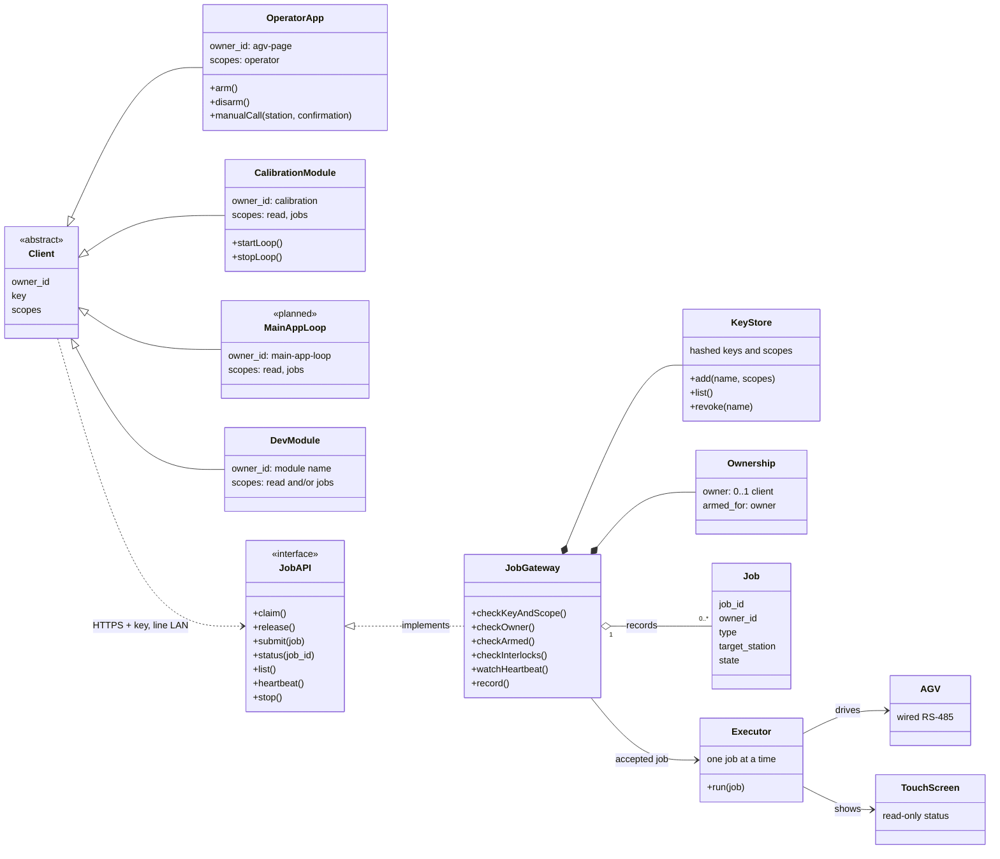

# Anodizing line operator manual

## Phase 1

Katana runs the operator app for the anodizing line. The wired AGV link can
connect, read status, arm, disarm and disconnect. Individual live station calls
are available only during a supervised manual-travel window and with the
required interlocks. The Calibration module runs test recipes, including
simulated timed dips and rinses. Live programme travel and chemical
processing are disabled. Standalone camera and robot Calibration, Teaching
and Pick/place use their existing native modules. See
[standalone setup](../START_HERE.md).

## Architecture

- **Katana** hosts the operator app and the built-in **Calibration module**
  (`programme.py`), which runs today's testing loop and owns its recipes,
  limits, next step and basket records. The planned **Main app loop** will
  orchestrate normal production.
- **Vehicle IPC** is the executor. It runs one accepted job at a time and
  owns the wired RS-485 connection to the AGV. It retains job instructions,
  checkpoints and results. Katana retains the recipe and plan state. The IPC
  touchscreen shows cached read-only status, including its age.
- **Line PLC** owns process timing. Katana's Line view can read a configured
  supplier API. Live immersion control needs separately qualified local
  evidence on the executor. See [architecture and phase boundaries](ARCHITECTURE.md).



The example installation serves the Katana page on loopback port `8880`.
Katana and developer modules reach the same IPC gateway over pinned HTTPS on
the line LAN, default port `18875`. Each caller uses a scoped service key.
The IPC kiosk reads its separate cached display on loopback port `18874`.
SSH is used for administration and deployment. A local development UI defaults
to `8870`.

| Example line network | Address |
| --- | --- |
| Katana line interface | `192.168.1.223/32` with a host route to the IPC |
| IPC line interface | `192.168.1.251` |
| Read-only PLC API | `http://192.168.1.12:8000` |
| UR10e segment | `192.168.12.0/24` with IPC `192.168.12.1` and UR10e `192.168.12.248` |

The IPC host route provides only the IPC path. PLC access requires its own
reviewed line route. The [example site profile](site-profile.example.json)
uses the application's JSON profile format. The service reads
`site-profile.json` from its data directory. Provision `PLC_API_KEY`
privately and verify the supplier read paths before enabling live line reads.
The IPC binds its HTTPS gateway to the profile's IPC address and accepts
only the configured line subnet. The IPC firewall enforces that boundary.
Configure OS routes, certificates, and keys as documented for the
[module gateway](MODULE_JOBS.md).

### Saved operator key

On first use after deployment, choose **Enroll this browser** and paste the
saved key provided by the administrator. The browser remembers enrollment.
An unenrolled browser can read the page and use software Stop. Enroll again
after changing browser profiles, clearing cookies, or rotating the key.
See [browser enrollment](MODULE_JOBS.md#enroll-the-katana-operator-browser).

## Jobs and recovery

The IPC job gateway serves the AGV page, the Calibration module and authorized
developer modules directly. The built-in Calibration module uses the same
ownership rule and a derived key. The API, UI and records use
`agv-page` for manual control, `calibration` for the testing loop, and the
registered name for a developer module. `main-app-loop` is reserved for
production. The gateway refuses that owner until the production loop exists.
One owner at a time may control the executor. The UI shows who holds it,
who is Armed, and recent client jobs. A change of owner disarms. Only the
operator at the e-stop Arms for the new owner. The IPC auto-checks eligible
module jobs and the operator confirms each manual call.

Operators use the Katana app. Developer modules use the IPC HTTPS API with
their own key and can read only their own jobs. See the
[API and key scopes](MODULE_JOBS.md#api).

| Operation | What it does |
| --- | --- |
| `GET /v1/health` | Reports the executor build, boot ID, protocol major and job versions. Protocol 2 peers require a matching major for control. |
| `GET /v1/status` | Reports current job, device status and freshness, lease, Stop generation and recovery state. Use `?job_id=…` to look up a retained job and its checkpoint and result. |
| `POST /v1/submit` | Carries `job_id`, `type`, `version` and `params` with current control authority. A manual call also carries its recorded confirmation. With valid authority, the same ID and payload return the recorded job. Reusing an ID with different content conflicts. A valid new request can receive a recorded busy refusal. |
| `POST /v1/heartbeat` | The Katana service renews the lease for the current boot and session. Defaults are one heartbeat per second and expiry three seconds after the last valid heartbeat. |
| `POST /v1/stop` | Accepts an authorized software Stop even while disarmed, busy or without a live lease. Receipt, halt attempt and confirmation are separate. |

The executor accepts `station_visit` version 1. A command acknowledgement
means it received the command. Arrival requires fresh stopped feedback at
the requested station. The fake executor also supports `dip` version 1.
It runs the paired place, dwell, lift and transfer against fake devices and
records measured timing and the final hold. Live dips, taught-endpoint
resolution and production robot work belong to a later phase.

Katana records intent before dispatch. The IPC saves acceptance before
execution and records intent and evidence around each physical effect.
Job states include `running`, `done`, `stopped`, `refused`, `failed` and
`interrupted`. Check the result and checkpoint for the physical outcome.
A job can finish with an uncertain outcome and require **Operator check**.

**Stop and link loss.** Katana latches Stop and sends it ahead of journal
writes. The IPC latches its own Stop generation, disarms, prevents new
physical steps and prioritizes the halt attempt on a motion-capable
connection. Confirmation requires fresh, stopped feedback after the halt
attempt from the current IPC boot. If the link drops, Katana freezes
dispatch on doubt. The IPC independently holds and disarms on lease expiry.
When a Stop stays unconfirmed, use the physical e-stop for immediate
intervention. Katana delivers a pending Stop on reconnect before allowing
re-arm or dispatch.

**Operator check.** If a reply, location, basket, interlock or retained record
leaves the physical outcome in doubt, the executor holds and disarms, and
Katana preserves the original request and freezes the plan. Read status
without repeating the command. In the Calibration module, physically check the
basket and location, record the observations, then choose **Resume from
step N** or **Abort basket**. Resume uses the pinned recipe, fresh authority
and a new job ID. Abort flags the basket for inspection. For a manual
station visit, the AGV page offers **Abort station visit** or **Confirm safe
hold** after the operator checks the AGV's location. If the page says to
call a technician, preserve the named evidence and have it reviewed.

**Records.** In Katana's private data directory, `programme/programme.json`
and its companion files retain basket history, pinned revisions, job IDs,
measured timing and decisions. `executor-manual-visit.json` and
`executor-stop.json` preserve manual-visit and Stop state. Use **Records**
in the UI for operator recordings stored under `records/`. The IPC keeps
`.jobs/` and `.executor-journal` with the accepted work and checkpoints,
and `agv-wire.jsonl` for wired traffic. Keep the full private directories and
their companion files together when archiving evidence. See
[data handling](../state/README.md).

## Operator use

### AGV controls

Open **AGV** in Katana at `/operator/#/agv`. Only the operator at the
physical AGV e-stop may arm or confirm a live station call.

1. Select the wired path, shown as **IPC executor** on an executor-backed
   installation, and choose **Connect**. Choose **Query status**. Review the
   mode, freshness, station, learned count, battery and faults.
2. For a live call, verify that the supervised window is open. Arm only
   with fresh stationary feedback. Select a permitted station and verify
   the destination in the confirmation. Confirm that you are at the e-stop,
   the arm is folded, and the path and tank equipment are clear. Choose
   **Confirm and call** for this call only. Watch for arrival and acknowledge
   the result when requested.
3. Use the page **Stop** for a software stop. Confirm that the AGV is stopped.
   Use the physical e-stop when immediate intervention is needed. For a
   normal shutdown, **Disarm**, then **Disconnect**.

The wired field `max_stations` counts learned legs. A positive count
allows calls from station 1 (the start) through the count plus one, up to
station 255. One learned leg allows stations 1 and 2. Zero allows no calls.
Use station-call mode. For new tape or missing legs, perform the attended
learning run with the AGV's green button and the XBOT station guide V1.61,
pages 2–3. Query status and check the reported range against the floor marks.

Read the refusal next to the affected control. **Tick Armed to enable
movement** calls for a fresh operator arm. **Wait for a fresh status report**
calls for a new status read. Clear any reported obstacle or fault before
calling a station. Low battery, an expired window, an outstanding Stop or
Operator check, or a station outside the learned range can also block travel.

The commissioning owner sets the IPC's `ANODIZING_MANUAL_TRAVEL_UNTIL`
to an absolute UTC expiry. The supervised procedure uses a three-hour
window. A restart with that same deadline preserves the original expiry.
Without a window the link supports commissioning controls and status.
The supervised line tape runs beside the tanks. During travel the UR10e
stays folded. Tank-clear and equipment-off signals are still pending on this
test path. Check the path and equipment by eye before each call. The IPC
uses fresh AGV battery percentage for reserve. Ordinary wired travel requires
qualified local robot pose, battery reserve and fresh tank-clear and
equipment-off feedback. See the
[supervised test configuration](ARCHITECTURE.md#supervised-manual-station-calls).

### Bluetooth maintenance

Use the **Bluetooth** tab on the AGV page for maintenance. The real site
profile supplies the device identity privately. Disarm and disconnect
wired control before opening Bluetooth. A Bluetooth session blocks wired
Connect and Arm. Use **Read settings** to inspect the supported fields.
For a permitted change, review the old and new values, then confirm the
write. Review and confirm Undo to restore a supported previous value.
Disconnect when finished. The learned count shown here comes from
wired evidence. The stored route cannot be read over Bluetooth.

### Calibration module

Open **Pick/place** at `/operator/#/pick-place` and find the simulated
programme panel for the Calibration module. With the fake executor
configured, review the effective recipe revision and DRAFT limits. Enter
the basket ID and confirm the basket at input. Choose **Run Calibration simulation**. The panel shows progress,
reported measurements, holds and inspection flags. **Stop programme**
requests a software Stop. Use the displayed **Operator check** if
requested. A measured limits breach raises an alarm and flags the
basket for inspection. Keep the measurements for the operator's decision.

## Developer use

From the repository root, use a separate data directory and port.
The launcher can use a prepared Python environment through
`ANODIZING_PYTHON`. The following starts the local orchestrator without
a remote executor, in live-line-disabled mode.

```bash
./start-ui.sh --help
ANODIZING_ROLE=orchestrator ANODIZING_EXECUTOR_PORT=0 ANODIZING_DISABLE_SIMULATION=0 \
  ./start-ui.sh --no-browser --port 8872 --data-dir ./offline-ui-data --line-mode disabled
```

Open `http://127.0.0.1:8872/operator/#/agv`, select **Simulator** and
choose **Connect**. Stop the local process with Ctrl-C. To exercise the
Calibration module, add `--programme-file` pointing to a synthetic JSON list of
steps with `id`, `tank`, `role`, `station` and positive `setpoint` in
seconds. In the local data directory, create
`simulation-executor/fake-plc-setpoints.json` with a JSON object mapping
the synthetic tank IDs to their independent fake PLC setpoints. Both
setpoints must agree for a dip. For a two-process simulation through the actual gateway, set up the
[fake HTTPS executor](MODULE_JOBS.md#local-fake-instance) in a separate
data directory.

Run the offline checks from the repository root with Python 3.11+ and the
app and test requirements installed, plus Node and the pinned UI dependencies.
The [UI build instructions](../src/anodizing-modules/operator-ui/README.md)
describe installation from an offline npm cache.

```bash
(cd src/anodizing-modules && ./tools/test-all.bash)
(cd src/anodizing-modules/operator-ui && npm test)
(cd src/anodizing-modules/operator-ui && npm run build)
```

Set `ANODIZING_PYTHON` to the prepared interpreter if needed. Vite writes
into the packaged `app/anodizing_web/operator_dist/` directory. For a
docs-only build check, use a disposable checkout.

**Katana API.** Reuse the same-origin client in
[api.js](../src/anodizing-modules/operator-ui/api.js). The browser uses the
operator session cookie once enrolled. `GET /api/agv?cached=1` reads AGV state
and `POST /api/agv` handles operator actions. `GET /api/programme` reads
Calibration module state and `POST /api/programme` handles review and run
actions. Developer modules use the [IPC API](MODULE_JOBS.md#api).

**Adding a developer module.** Use only the [keyed IPC API](MODULE_JOBS.md)
for jobs, status and Stop. Future cameras, UR10e, tower light and PLC data
will also use keyed APIs. For a built-in operator UI change, reuse the existing
native core behind the Python service. Add the protected handler in
[server.py](../src/anodizing-modules/app/anodizing_web/server.py),
wire the page into the existing Vue routes and sidebar, and follow the
[UI ID registry](../src/anodizing-modules/operator-ui/UI_IDS.md).
Keep Calibration, Teaching and Pick/place runnable independently of the
operator app. Route any hardware work through the existing owner and
Stop path. Verify behavior with fake devices.

**Deployment overview.** Build and test the release locally. An authorized
maintainer installs the reviewed Python package and its built UI under
the appropriate role, provisions private site data and credentials, and
checks role, health, cached status and recovery evidence before enabling
any approved controls. Keep the executor service identity and evidence
retention stable and follow the release's data migration procedure. See
[installation roles](ARCHITECTURE.md#installation-roles) and
[UI packaging](../src/anodizing-modules/operator-ui/README.md#build-and-package).

## Safety rules and known limits

- Keep one orchestrator and one owner of the wired AGV bus. Modules use
  the Katana service and approved executor interfaces. Keep serial ports
  and raw device frames inside the hardware adapters.
- Treat web Stop as a software request. Confirm stopped state from evidence
  and use the physical e-stop for emergency intervention. Only the operator
  at that e-stop may arm or confirm a live call.
- Keep fakes as the development default. Review role, interlocks, status age
  and current approvals before any supervised live session. Keep local
  radio operation to a deliberate maintenance changeover with verified
  release of the previous owner.
- Preserve evidence after a Stop or ambiguous job. Read status and obtain
  the operator's decision before any further physical work.

Phase 1 offline checks cover software behavior with fake devices. Live
interlocks, stopping distance, link timing, and production dip recovery
still require site qualification. See [open findings](OPEN_FINDINGS.md)
for current software risks and [phase acceptance](ARCHITECTURE.md#phase-acceptance-and-next-phase)
for the remaining hardware work.
