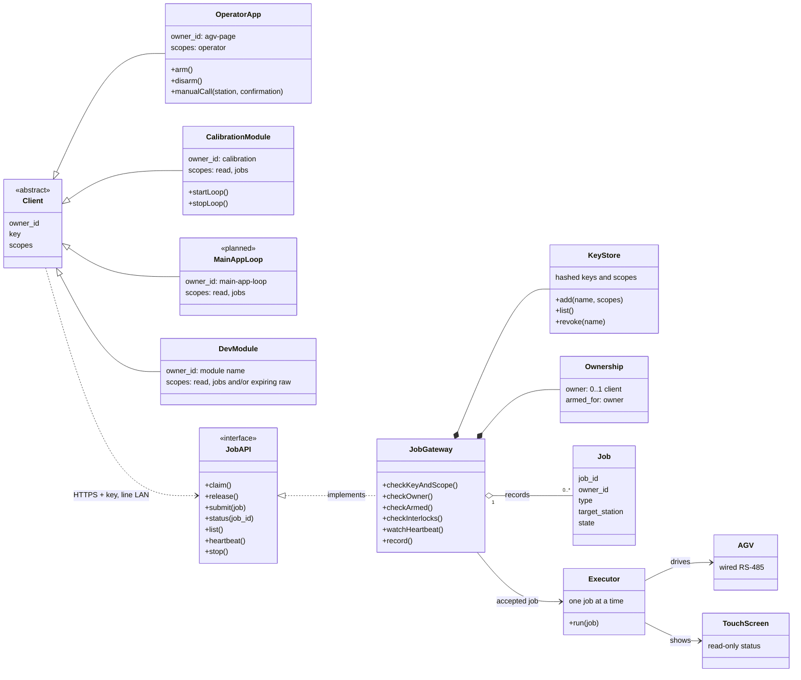

# Anodizing line operator manual

## Phase 1

Katana runs the operator app for the anodizing line. The wired AGV link can
connect, read status, arm, disarm and disconnect. Live station visits
are available only during a supervised manual-travel window and with the
required interlocks. The Calibration module runs test recipes, including
simulated timed dips and rinses. Live programme travel and chemical
processing are disabled. Standalone camera and robot Calibration, Teaching
and Pick/place use their existing native modules. See
[standalone setup](../START_HERE.md).

## Architecture

- **Katana** hosts the operator app and the built-in **Calibration module**
  (`programme.py`), which runs today's testing loop and owns its recipes,
  limits, next step and basket records. The planned **Main app loop** will
  orchestrate normal production.
- **Vehicle IPC** is the executor. It runs one accepted job at a time and
  owns the wired RS-485 connection to the AGV. It retains job instructions,
  checkpoints and results. Katana retains the recipe and plan state. The IPC
  touchscreen shows cached read-only status, including its age.
- **Line PLC** owns process timing. Katana's Line view can read a configured
  supplier API. Live immersion control needs separately qualified local
  evidence on the executor. See [architecture and phase boundaries](ARCHITECTURE.md).



The example installation serves the Katana Dev console at
`http://dev.localhost:8880/dev/` on loopback.
Katana and developer modules reach the same IPC gateway over pinned HTTPS on
the line LAN, default port `18875`. Each caller uses a scoped key. Katana
sends operator Stop on pinned HTTPS port `18876` first and falls back to
`18875` with the same Stop ID. The IPC kiosk reads its separate cached
display on loopback port `18874`.
SSH is used for administration and deployment. A local development UI defaults
to `8870`.

| Example line network | Address |
| --- | --- |
| Katana line interface | `192.168.1.223/32` with a host route to the IPC |
| IPC line interface | `192.168.1.251` |
| Read-only PLC API | `http://192.168.1.12:8000` |
| UR10e segment | `192.168.12.0/24` with IPC `192.168.12.1` and UR10e `192.168.12.248` |

The IPC host route provides only the IPC path. PLC access requires its own
reviewed line route. The [example site profile](site-profile.example.json)
uses the application's JSON profile format and stays under `docs/` for
reference. The service reads `site-profile.json` from its data directory. Provision `PLC_API_KEY`
privately and verify the supplier read paths before enabling live line reads.
`executor_link.route_address` lets Katana identify the line interface for
the link banner. The IPC binds its HTTPS gateway to the profile's IPC address.
The IPC firewall admits the configured subnet on the line interface and
the IPC's own line address on loopback for port 18875. Reserved Stop on port
18876 stays on Katana's line-LAN path.
Configure OS routes, certificates, and keys as documented for the
[module gateway](MODULE_JOBS.md).

## Jobs and recovery

The IPC job gateway serves the AGV page, the Calibration module and authorized
developer modules. The built-in Calibration module follows the same
ownership rule using a key derived from Katana's service key. It needs
no separate key file. The API, UI and records use
`agv-page` for manual control, `calibration` for the testing loop, and the
registered name for a developer module. `main-app-loop` is reserved for
production. The gateway refuses that owner until the production loop exists.
One owner at a time may control the executor. The UI shows who holds it,
who is Armed, and recent client jobs. A change of owner disarms. Only the
operator at the e-stop Arms for the new owner. For a module, that Arm
includes the operator's confirmation that the arm is folded and the path
and tank equipment are clear. The IPC records the confirmation against the
module's lease and executor boot for up to 30 minutes. The IPC checks the
supervised travel window and applicable interlocks for every module visit.
Module station visits and raw motion on the isolated track require the IPC
opt-in described below. At the final send, the IPC rechecks the current
owner and lease, the Arm confirmation and the Stop generation. Develop
and test module jobs with the fake gateway.

Operators use the Katana app. Developer modules on the line LAN or on the IPC
itself connect to `https://192.168.1.251:18875` with the same pinned certificate
and their own scoped keys. Both follow the same ownership, Arm confirmation,
track and supervised travel-window rules. They see their own jobs.
The operator sees jobs across clients. The installation starts with zero
developer keys. See [key provisioning and API examples](MODULE_JOBS.md).

| Operation | What it does |
| --- | --- |
| `GET /v1/health` | Reports the executor build, boot ID, protocol major and job versions. Protocol 2 peers require a matching major for control. |
| `GET /v1/status`, `GET /v1/jobs` | Show the current owner, Arm binding, device state and the jobs visible to the caller. Use `status?job_id=…` to read retained evidence for one job. |
| `POST /v1/claim`, `POST /v1/release` | Claim an idle executor and retain its lease ID. Release when work has settled. Changing or releasing ownership disarms. |
| `POST /v1/submit` | Sends `job_id`, `type`, `version` and `params` with current authority. A module sends its lease ID and Stop generation. A manual call carries the operator confirmation. The same ID and payload return the current recorded disposition, including a retained refusal. A jobs-only key receives the same minimal receipt format at first acceptance and on retry. Changing the payload conflicts. |
| `POST /v1/heartbeat` | An external module advances the sequence on its lease each second. Ten seconds without a valid renewal cause Stop, hold, disarm, ownership release and Operator check. The Katana service heartbeat defaults to one second with a three-second lease. |
| `POST /v1/stop` | Accepts a software Stop with any valid IPC key, even while disarmed, busy or without a live lease. Receipt, halt attempt and confirmation are separate. |
| `POST /v1/raw` | Runs an allowlisted wired command under an expiring development grant. Motion requires the current lease and Arm confirmation. Speed changes require a stopped, disarmed vehicle and can only lower the setpoint. The IPC rechecks the grant at the send. |
| `POST /v1/raw/undo` | Restores the exact value from the latest eligible speed snapshot, using its original key and the same vehicle with unchanged read-back. The IPC journals the restore and verifies read-back. |

The IPC checks both the calendar cutoff and the boot-time deadline at
authentication and final send. The earlier deadline ends raw access.
The running executor latches observed expiry so a clock rollback cannot
restore raw access. An IPC reboot invalidates the raw scope. Other scopes on
the key remain available.

The executor accepts `station_visit` version 1. A command acknowledgement
means it received the command. Arrival requires fresh stopped feedback at
the requested station. The fake executor also supports `dip` version 1.
It runs the paired place, dwell, lift and transfer against fake devices and
records measured timing and the final hold. Live dips, taught-endpoint
resolution and production robot work belong to a later phase.

Katana records intent before dispatch. The IPC saves acceptance before
execution and records intent and evidence around each physical effect.
Job states include `running`, `done`, `stopped`, `refused`, `failed` and
`interrupted`. Check the result and checkpoint for the physical outcome.
A job can finish with an uncertain outcome and require **Operator check**.

**Stop and link loss.** Katana latches Stop and attempts the primary
send. The fallback dispatch proceeds independently of the local witness
write. The AGV page reports primary-route failure even if the fallback
delivers the Stop. Port `18876` bounds and times out unauthenticated
connections separately from authenticated operator Stop requests.
The IPC latches its own Stop generation, disarms, prevents new
physical steps and prioritizes the halt attempt on a motion-capable
connection. Confirmation requires fresh, stopped feedback after the halt
attempt from the current IPC boot. If the link drops, Katana freezes
dispatch on doubt. The IPC independently holds and disarms on lease expiry.
When a Stop stays unconfirmed, use the physical e-stop for immediate
intervention. Katana delivers a pending Stop on reconnect before allowing
re-arm or dispatch. A confirmed Stop leaves the IPC disarmed. A valid owner
remains selected until release or lease loss.

The **AGV link lost since** banner shows when the outage was detected and
gives a check for the line Wi-Fi or the IPC. When **Link back at** appears,
follow its link to the AGV page, reconnect and query status. Resolve any
pending Stop or Operator check before a fresh Arm.

**Operator check.** If a reply, location, basket, interlock or retained record
leaves the physical outcome in doubt, the executor holds and disarms, and
Katana preserves the original request and freezes the plan. Read status
without repeating the command. In the Calibration module, physically check the
basket and location, record the observations, then choose **Resume from
step N** or **Abort basket**. Resume uses the pinned recipe, fresh authority
and a new job ID. Abort flags the basket for inspection. For a manual
station visit, the AGV page offers **Abort station visit** or **Confirm safe
hold** after the operator checks the AGV's location. If the page says to
call a technician, preserve the named evidence and have it reviewed.

**Records.** In Katana's private data directory, `programme/programme.json`
and its companion files retain basket history, pinned revisions, job IDs,
measured timing and decisions. `executor-manual-visit.json` and
`executor-stop.json` preserve manual-visit and Stop state. Use **Records**
in the UI for operator recordings stored under `records/`. The IPC keeps
`.jobs/` and `.executor-journal/` with job evidence and checkpoints, and
`agv-wire.jsonl` for wired traffic. Job records attribute the client and key ID.
The gateway stores only key hashes in the key registry. Keep the full private directories and
their companion files together when archiving evidence. See
[data handling](../state/README.md).

## Operator use

### Saved operator key

On the Katana desktop, open the **Dev console** shortcut or go to
**http://dev.localhost:8880/dev/** and choose **Enroll this browser**. Paste
the saved key provided by the administrator. Enrollment lasts at most 12 hours in that browser tab,
including reloads. The browser sends the credential only to this origin,
including its port. Enroll again in a new tab or after expiry or key
rotation. Enroll once when you first open the new address. Old bookmarks
redirect to the same hash route and drop their query strings. An unenrolled
browser can read the page and use software Stop.
See [browser enrollment](MODULE_JOBS.md#enroll-the-katana-operator-browser).

### AGV controls

Open **AGV** in Katana at `/dev/#/agv`. Only the operator at the
physical AGV e-stop may arm or confirm a live station call.

1. In **Connection**, select the wired path, shown as **IPC executor** on
   an executor-backed installation. Choose **Connect** beside the page title.
   Choose **Query status** in **Connection**. Review the mode, freshness,
   station, learned count, battery and faults.
2. Choose **Select AGV page** under **Job ownership**. For a live call,
   verify the supervised window and fresh stationary feedback, then use
   **Armed** at the physical e-stop. Verify **Armed for AGV page**.
3. Open **Stations & move**, select a permitted station and verify the
   destination in the confirmation. Confirm that you are at the e-stop, the arm is folded,
   and the path and tank equipment are clear. Choose **Confirm and call**
   for this call only. Watch for arrival and acknowledge the result when
   requested.
4. Use the page **Stop** for a software stop. Confirm that the AGV is stopped.
   Use the physical e-stop when immediate intervention is needed. For a
   normal shutdown, disarm with the **Armed** switch and choose **Disconnect**.

For a module visit, have the module claim control or select the Calibration
module under **Job ownership**. At the physical e-stop, check the arm,
path and tank equipment, then choose **Armed**. Verify the module in the
dialog, enter the operator's name and choose **Confirm and Arm**.
Check the module name, local expiry time and countdown
on the AGV page. Arm again after expiry, ownership change, release,
heartbeat loss, Stop, Operator check, disarm, disconnect or executor
restart. Expiry blocks the next move. An in-progress move follows the
existing arrival and Stop rules.

The wired field `max_stations` counts learned legs. A positive count
allows calls from station 1 (the start) through the count plus one, up to
station 255. One learned leg allows stations 1 and 2. Zero allows no calls.
Use station-call mode. For new tape or missing legs, perform the attended
learning run with the AGV's green button and the XBOT station guide V1.61,
pages 2–3. Query status and check the reported range against the floor marks.

The AGV and Bluetooth pages name the blocked or refused action and show
the reason and next step. For stale feedback, choose **Query status**.
For an owner or Arm refusal, check **Job ownership** and **Armed for**.
Station controls above the learned range are disabled and show the
reported range. On either page, a **Last known** report shows the previous
reading and time. Follow **Tell the technician** for an unknown reason and
preserve the reported code.

The commissioning owner sets the IPC's `ANODIZING_MANUAL_TRAVEL_UNTIL`
to an absolute UTC expiry. The supervised procedure uses a three-hour
window. A restart with that same deadline preserves the original expiry.
Without a window the link supports commissioning controls and status.
The supervised line tape runs beside the tanks. During travel the UR10e
stays folded. Tank-clear and equipment-off signals are still pending on this
test path. Check the path and equipment by eye before confirming a manual
call. By default, the isolated track blocks module station visits and
raw motion. The IPC's `ANODIZING_MODULE_TRAVEL_ON_ATTESTED_TRACK=1`
allows them during the open window with a current, owner-, lease- and
boot-bound Arm confirmation and fresh battery above the floor. On this
track the operator's Arm confirmation supplies the folded-arm, clear-path
and clear-equipment checks in place of the hardware interlocks. Page
station calls still require their own confirmation. The IPC uses fresh
AGV battery percentage for reserve. Ordinary wired travel requires
qualified local robot pose, battery reserve and fresh tank-clear and
equipment-off feedback. See the
[supervised test configuration](ARCHITECTURE.md#supervised-manual-station-calls).

### IPC touchscreen

The black status screen uses a word, symbol and colour to show what the
AGV is doing. Station, battery and fault are the large readouts. The
current or last job is below them. Owner, Arm time, lease, heartbeat,
tower light, data age and build appear in the footer. When the cached
screen data is about three seconds old, the screen turns grey and asks
staff to call the operator. A current Stop or recovery warning stays
visible while the executor still reports it. The loopback display on
port `18874` serves cached state and has no controls.

The battery readout and Dev console Overview show **Charging**, **In use**
or **Steady** when enough fresh readings are available. Below 20%, the
warning is amber. Below 10%, it is red. For wired charging, switch the
vehicle off, use its dedicated charger and stay nearby.

The XBOT RS485 protocol 260917 (pp. 2–3) reports the battery percentage in
`0x25`. A `0x26` query returns the same fields, with no charger flag.
The V2.0 0812 manual (pp. 10, 12) shows a charging indicator in the vendor
app, specifies wired charging with the vehicle off, and lists wireless
charging as optional. The IPC receives no feedback from a switched-off
vehicle. Use the wired charger indicator to check charging in that case.

The IPC status API reports the estimate as `device.battery_trend`
(`charging`, `in_use`, `steady` or `null`). The executor samples fresh
reports about every 20 seconds in memory, compares medians at the ends
of a 10-minute window, and ignores a change of one percentage point.
The label needs at least three minutes of continuous feedback. Missing
or invalid readings clear the history, and the label disappears on
disconnect or when the last report is three seconds old.

The IPC user service starts the screen during graphical login if
HDMI-A-1 is the sole connected and enabled physical output, and checks
again every two seconds for a display powered on later. It closes its
own viewer on disconnect and restarts an exited viewer with a delay.
The viewer stays below developer windows and rejects input focus.
Install `tools/anodizing-ipc-kiosk.service` in
the IPC account's systemd user-unit directory and enable it with
`systemctl --user enable --now`.
The unit reads the viewer from the current IPC release.

### Tower light

The common-positive tower light shares +24 VDC with PCOM and uses 0 V at
ECOM2. DO0 is red, DO1 yellow, DO2 green and DO3 the buzzer. The IPC executor
drives the light from its own state.

| Indication | Executor state |
| --- | --- |
| Green | Idle with fresh, stopped and fault-free AGV feedback |
| Amber | Armed with fresh feedback, including a current module Arm confirmation |
| Flashing amber | Movement dispatched or feedback shows travel, including a handheld remote call |
| Red | Software Stop, an obstacle stop, a fault, or a check needed |
| Flashing red | Recovering from link or lease loss |
| Off | Disconnected, waiting for fresh feedback, or no ready signal and no alarm |

Check the battery reserve and supervised travel window on the AGV page
before authorizing travel. Green only describes the current AGV feedback.

Flashes are about once per second. The buzzer beeps once when travel
starts and three times when Stop, a fault or a check begins. Beeps are
about 0.2 seconds. Use the AGV page to verify link and Arm status. Check
the touchscreen if the light is unavailable. A tower worker startup
failure leaves the executor gateway and priority Stop available. The
post-stop lamp clear has a two-second limit. Use the physical emergency
stop for emergencies.

The IPC's optional root-owned `/etc/anodizing-executor/tower-light.env`
accepts `ANODIZING_TOWER_LIGHT_ENABLED=1` to activate the display.
`ANODIZING_TOWER_LIGHT_DEVICE` defaults to `/dev/ttyACM0`. A stable
`/dev/serial/by-id/` symlink to the ECB-306 can be used instead. The default
polarity is active-high, as confirmed during the 2026-11-27 attended check.
If using an active-low board, set `ANODIZING_TOWER_LIGHT_ACTIVE_LOW=1` and
verify with an attended test. Logical all-off sends `GW00` at default
polarity and `GW0F` for active-low DO0–DO3.

For the attended IPC lamp test, confirm on the AGV page that the link is
disconnected, disarmed and idle. Keep it idle, stop the executor service,
then run the command while watching the light. It shows red, yellow,
green and buzzer for about one second each, then clears the outputs.

```sh
sudo systemctl stop anodizing-executor.service
sudo systemd-run --wait --pipe --collect --property=EnvironmentFile=-/etc/anodizing-executor/tower-light.env /opt/anodizing-executor/current/tools/anodizing-tower-light test
```

After checking polarity, set `ANODIZING_TOWER_LIGHT_ENABLED=1` in that file
and run `sudo systemctl start anodizing-executor.service`. The test acquires
the same lock as the executor and requires an IPC administrator.

### Bluetooth maintenance

Use the **Bluetooth** tab on the AGV page for maintenance. The private site
profile supplies the device identity. With wired control disconnected,
disarmed and idle, choose **Connect**, then **Read settings**. A Bluetooth
session blocks wired Connect and Arm. Review the old and new value before
confirming a supported setting write. **Review undo** can restore the
previous value of a supported write.

**Stored Bluetooth route** shows outbound and return counts. Expand
**Station records** to inspect available rows. The separate **RS485
learned route** uses wired status. Check its timestamp if it shows the
last known report.

During approved maintenance with the AGV parked, choose **Clear route**
to review both directions. **Confirm route clear** permanently erases
the stored route. Check both post-clear counts. Disconnect Bluetooth.
For relearning, follow the displayed attended green-button procedure and
check the learned range with **Query status** on the AGV page. Bluetooth
motion and Stop controls are unavailable.

### Calibration module

Open **Pick/place** at `/dev/#/pick-place` and find **Calibration
module**. In a two-process simulation using the gateway, use **Select
Calibration module** under **Job ownership** on the AGV page and confirm Arm
for it in the fake instance.
Review the effective recipe revision and DRAFT limits. Enter the basket ID,
confirm the basket at input, and choose **Run Calibration simulation**. The
panel shows progress,
reported measurements, holds and inspection flags. **Stop programme**
requests a software Stop. Use the displayed **Operator check** if
requested. A measured limits breach raises an alarm and flags the
basket for inspection. Keep the measurements for the operator's decision.

## Developer use

From the repository root, use a separate data directory and port.
The launcher can use a prepared Python environment through
`ANODIZING_PYTHON`. The following starts the local orchestrator without
a remote executor, in live-line-disabled mode.

```bash
./start-ui.sh --help
ANODIZING_ROLE=orchestrator ANODIZING_EXECUTOR_PORT=0 ANODIZING_DISABLE_SIMULATION=0 \
  ./start-ui.sh --no-browser --port 8872 --data-dir ./offline-ui-data --line-mode disabled
```

Open `http://127.0.0.1:8872/dev/#/agv`, select **Simulator** and
choose **Connect**. Stop the local process with Ctrl-C. To exercise the
Calibration module, add `--programme-file` pointing to a synthetic JSON list of
steps with `id`, `tank`, `role`, `station` and positive `setpoint` in
seconds. In the local data directory, create
`simulation-executor/fake-plc-setpoints.json` with a JSON object mapping
the synthetic tank IDs to their independent fake PLC setpoints. Both
setpoints must agree for a dip. For a two-process simulation through the actual gateway, set up the
[fake HTTPS executor](MODULE_JOBS.md#local-fake-instance) in a separate
data directory.

Run the offline checks from the repository root with Python 3.11+ and the
app and test requirements installed, plus Node and the pinned UI dependencies.
The [UI build instructions](../src/anodizing-modules/operator-ui/README.md)
describe installation from an offline npm cache.

```bash
(cd src/anodizing-modules && ./tools/test-all.bash)
(cd src/anodizing-modules/operator-ui && npm test)
(cd src/anodizing-modules/operator-ui && npm run build)
```

Set `ANODIZING_PYTHON` to the prepared interpreter if needed. Vite writes
into the packaged `app/anodizing_web/operator_dist/` directory. For a
docs-only build check, use a disposable checkout.

**Katana API.** Reuse the same-origin client. An enrolled tab sends
`X-Operator-Enrollment` only to the enrollment origin. In local mode
without browser enrollment, the
client sends `X-Module-Token` from the page's `module-token` meta tag.
`GET /api/agv?cached=1` reads AGV state and `POST /api/agv` handles operator
actions. `GET /api/programme` reads Calibration module state and
`POST /api/programme` handles review and run actions. AGV and Bluetooth
refusals can include `code`, `message` and `hint` alongside `error`. See
[the app client](../src/anodizing-modules/operator-ui/api.js) and
[refusal feedback](ARCHITECTURE.md#katana-agv-and-bluetooth-refusal-feedback).

**Adding a developer module.** Start with a synthetic key and the
two-process fake gateway. Claim an idle executor, keep the lease alive
while waiting for the operator's Arm, submit the job, read its result,
and release after it settles. Use the keyed IPC API for jobs, evidence and
Stop. Future devices will also use keyed APIs. See
[the gateway guide](MODULE_JOBS.md) and the
[example station client](../examples/module_station_visit.py). For a built-in operator UI change, reuse the existing
native core behind the Python service. Add the protected handler in
[server.py](../src/anodizing-modules/app/anodizing_web/server.py),
wire the page into the existing Vue routes and topbar navigation, and follow the
[UI ID registry](../src/anodizing-modules/operator-ui/UI_IDS.md).
Keep Calibration, Teaching and Pick/place runnable independently of the
operator app. Route any hardware work through the existing owner and
Stop path. Verify behavior with fake devices.

**Deployment overview.** Build and test the release locally. An authorized
maintainer installs the reviewed Python package and its built UI under
the appropriate role, provisions private site data and credentials, and
checks role, health, cached status and recovery evidence before enabling
any approved controls. Keep the executor service identity and evidence
retention stable and follow the release's data migration procedure. See
[installation roles](ARCHITECTURE.md#installation-roles) and
[UI packaging](../src/anodizing-modules/operator-ui/README.md#build-and-package).

## Safety rules and known limits

- Keep one owner at a time. Developer modules use the keyed IPC API.
  Only the executor owns the wired AGV bus. Keep serial ports and raw device
  frames inside the hardware adapters.
- Treat web Stop as a software request. Confirm stopped state from evidence
  and use the physical e-stop for emergency intervention. Only the operator
  at that e-stop may arm or confirm a live call.
- Keep fakes as the development default. Review role, interlocks, status age
  and current approvals before any supervised live session. Keep local
  radio operation to a deliberate maintenance changeover with verified
  release of the previous owner.
- Preserve evidence after a Stop or ambiguous job. Read status and obtain
  the operator's decision before any further physical work.

Phase 1 offline checks cover software behavior with fake devices. Live
interlocks, stopping distance, link timing, and production dip recovery
still require site qualification. See [open findings](OPEN_FINDINGS.md)
for current software risks and [phase acceptance](ARCHITECTURE.md#phase-acceptance-and-next-phase)
for the remaining hardware work.
