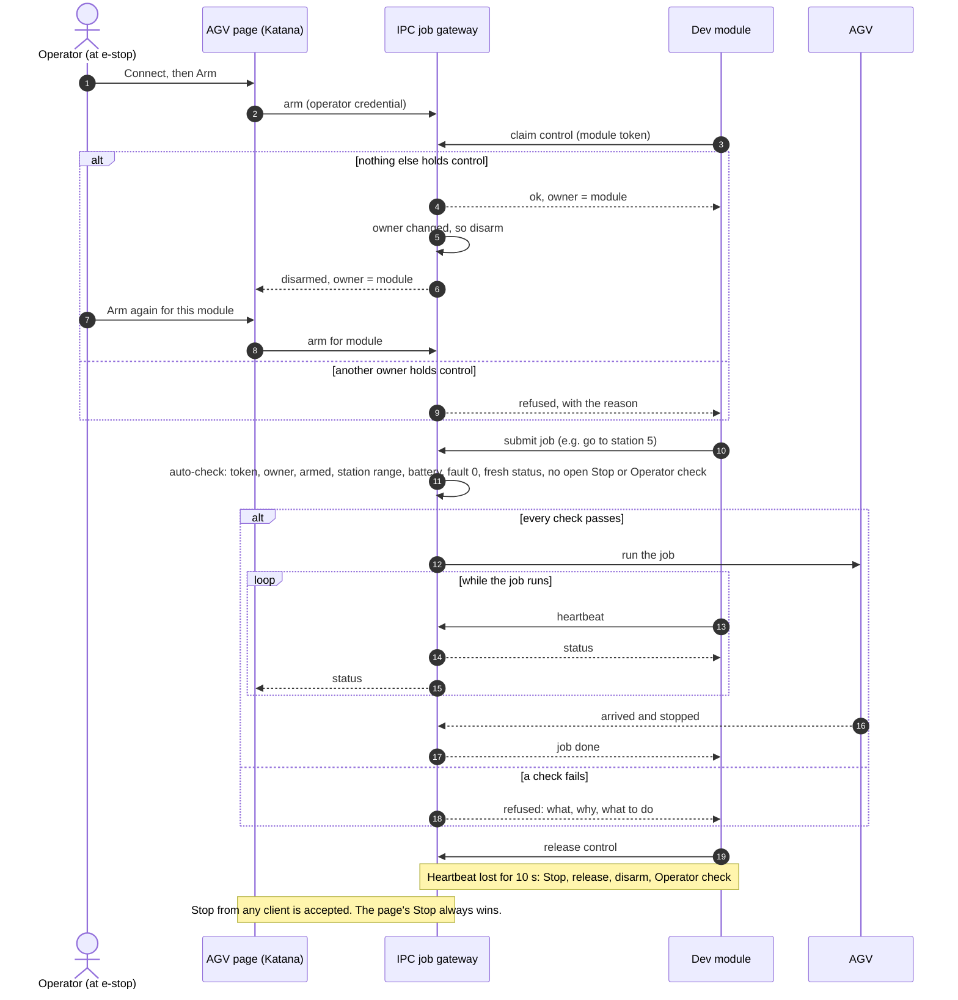
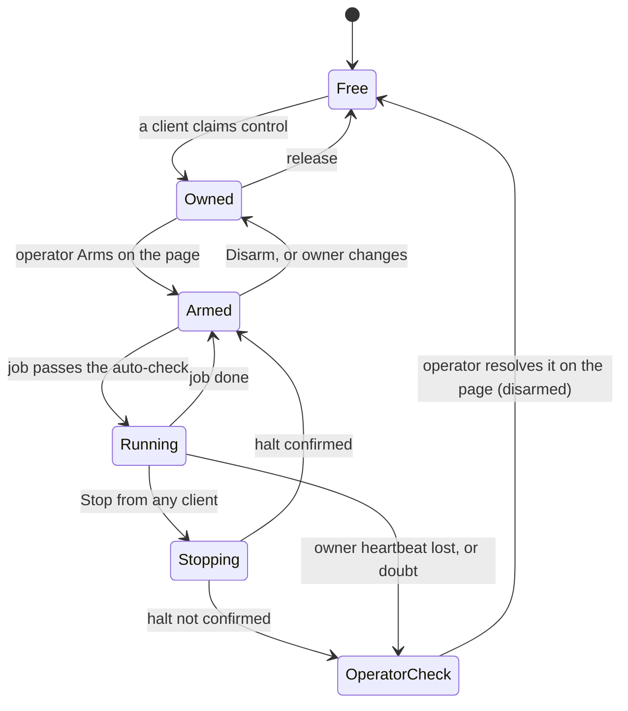

# IPC job gateway

The vehicle IPC owns admission, key scopes, one client lease and one executing
job. Katana hosts the AGV page and the built-in **Calibration module** for test
runs. The **Main app loop** is planned for production and its owner ID
`main-app-loop` is reserved. Katana retains the recipe and plan cursor. The
IPC keeps job evidence and knows nothing about the next plan step.

All clients use the same IPC HTTPS API on the line LAN. Katana uses its service
key for `agv-page` and a separate derived key for `calibration`. The built-in
Calibration module needs no extra key file. Developer modules use individual keys
and do not use Katana's browser API. SSH is for administration and deployment.

## Get a module key

Ask the IPC administrator to give the module only its necessary scopes. The
service starts with zero developer modules enabled. The IPC stores key hashes,
client names, key IDs and scopes. It never stores developer keys in job records.

On the IPC, use the admin command with the executor's stable data directory and
a new output directory. The source release includes the same command at
`tools/anodizing-module-token` in the installed bundle. Run it under the
executor data owner or as an administrator acting for that account.

```sh
anodizing-module-token --data-dir "$EXECUTOR_DATA" add example-module \
  --scope read --scope jobs --output-dir "$MODULE_KEY_DIR"
anodizing-module-token --data-dir "$EXECUTOR_DATA" list
anodizing-module-token --data-dir "$EXECUTOR_DATA" revoke example-module
```

Give `module.key` and `ipc-cert.pem` to the account that runs the module.
Keep the key file readable only by that account. Configure the clients with
the pinned certificate and the IPC line-LAN address given by the administrator.
A replacement key receives a new ID. Revocation denies subsequent requests
using the old key. The operator can still see records attributed to that key.

A module uses only keyed APIs for its operations. Module code has no direct
access to devices, application files, databases, Bluetooth, SSH or other
services. Installing its key and certificate is credential setup. Future
camera, UR10e, tower light and PLC resources will use keyed APIs as well.

## API

Send `Authorization: Bearer <key>` on every request, including Stop.
POST bodies use JSON. The values below show the shape of API calls.

| Request | Scope | Body or response |
| --- | --- | --- |
| `GET /v1/health` | `read` | Protocol, executor boot and capabilities |
| `GET /v1/status` | `read` | Current owner, Arm binding, interlock state and the caller's active job if any |
| `GET /v1/status?job_id=visit-1` | `read` | Retained state and evidence for the caller's job |
| `GET /v1/jobs` | `read` | List of the caller's job records |
| `POST /v1/claim` | `jobs` | Send `{}`. Retain the returned `lease_id`. |
| `POST /v1/heartbeat` | `jobs` | Send `{"lease_id":"your-lease","sequence":1}`. Advance the sequence on every renewal. |
| `POST /v1/submit` | `jobs` | Send the job below after reading the current Arm and Stop generation. |
| `POST /v1/release` | `jobs` | Send `{"lease_id":"your-lease"}` after work has settled. |
| `POST /v1/stop` | Any valid key | Send `{}` or supply a unique `stop_id` to identify a retry. |

```json
{
  "lease_id": "your-lease",
  "stop_generation": 42,
  "job_id": "visit-1",
  "type": "station_visit",
  "version": 1,
  "params": {"station": 2}
}
```

A repeated job ID and identical payload returns the existing record. A
changed payload conflicts. After an ambiguous response, read the original
job ID and follow the operator's recovery procedure. Preserve the original
job ID and evidence. Each job records the originating client and key ID.
The operator page can see jobs from all clients.

## Ownership, Arm and Stop

Claim only when the executor is idle and available. On the AGV page the
operator selects `agv-page` or `calibration`, or observes the name of the
module that claimed the executor. Releasing or changing owner disarms the IPC.
The operator at the physical e-stop connects and Arms for the current owner
on the AGV page. The page shows **Armed for** that owner. Manual calls from
the page keep their fresh per-call confirmation.

The IPC admits module requests automatically when the current owner, Arm
binding, fresh feedback, station range, battery, fault status, supervised
travel window and other interlocks allow the job. Stop and Operator check
fence positive commands. The isolated track currently uses a human's per-call
folded-arm observation. Automatic module calls there require qualified
physical evidence and otherwise receive a refusal. Live recipe travel and dips
remain fenced.

Keep heartbeats going during a job and while waiting to be Armed. Send one
each second. Ten seconds without an advancing heartbeat causes IPC Stop,
hold, disarm, ownership release and Operator check. Stop remains available
with any valid IPC key. The AGV page forwards Stop with its Katana service key
even from an unenrolled browser. A pending Stop latches ahead of ordinary
actions and stays pending across link loss until current-boot feedback after
the halt confirms it. The physical e-stop is the emergency control.

## Enroll the Katana operator browser

The administrator generates the browser key once on Katana and stores it in
a private file outside the application data directory. Configure the service
with `ANODIZING_OPERATOR_KEY_FILE`. Run it as the operator desktop account
and let the administrator access the file through the administrative account.
The service uses this key only for browser enrollment and stores the browser
session in an HttpOnly, SameSite=Strict cookie.

Open the operator page in the desktop browser, choose the enrollment link,
and paste the key. Confirm that the page leaves read-only mode. Keep
**Stop** accessible from any browser on the authorized local operator origin.
If a browser clears its cookie or uses a new profile, enroll again. To revoke
old enrollment, replace the key file and restart the operator service.
Browser, Katana service and developer keys have separate uses.

## Transport and firewall

Set `line_network.ipc_address`, `line_network.line_subnet` and
`line_network.ur10e_subnet` in the IPC's private site profile. The HTTPS
port defaults to 18875 and may be set with `line_network.module_api_port`.
Generate the self-signed certificate on the IPC with the IPC address in its
IP subject alternative name. Put `module-api-cert.pem` and the private
mode-0600 `module-api-key.pem` in the executor data directory. Only the
public certificate is copied to clients. Replace both configured pins
before rotating the executor certificate.

Apply an IPC input firewall rule allowing the gateway port only from the
configured line subnet on the line interface, followed by a deny for other
sources. The listener also rejects sources outside the configured subnet.
Failed-key responses are rate-limited and logged without recording keys.
The separate cached loopback status display remains available to the kiosk.

Set Katana's executor port, `ANODIZING_EXECUTOR_CERT_FILE` and
`ANODIZING_EXECUTOR_TOKEN_FILE`. Katana uses `line_network.ipc_address`
in its own private site profile. The IPC credential file holds two SHA-256 hashes, one for the Katana service
key and one for the derived Calibration key. The lines use
`sha256:<operator-digest>` and `calibration-sha256:<calibration-digest>`.
The AGV controls and operator job list use the operator key. The Calibration client
uses its derived key for its own jobs. Katana's browser cookie is a separate
credential.

## Local fake instance

Use two private scratch data directories. Put this synthetic
`site-profile.json` in both, using free ports for the three IPC listeners
and the Katana browser app.

```json
{
  "line_network": {
    "ipc_address": "127.0.0.1",
    "line_subnet": "127.0.0.0/8",
    "ur10e_subnet": "192.0.2.0/24",
    "module_api_port": 18875
  }
}
```

In the fake IPC directory generate a temporary certificate with
`subjectAltName=IP:127.0.0.1`. Use distinct synthetic keys for IPC service and
browser enrollment and keep their files mode 0600 outside the browser data
directory. Start two instances from the repository root.

```sh
./start-ui.sh --no-browser --role executor --fake-executor \
  --port 18873 --status-display-port 18874 --data-dir "$FAKE_IPC_DATA" \
  --executor-token-file "$FAKE_IPC_SERVICE_KEY"

./start-ui.sh --no-browser --port 8870 --data-dir "$FAKE_KATANA_DATA" \
  --executor-port 18875 --executor-token-file "$FAKE_IPC_SERVICE_KEY" \
  --executor-cert-file "$FAKE_IPC_DATA/module-api-cert.pem" \
  --operator-key-file "$FAKE_BROWSER_KEY"
```

Provision a synthetic module key with both scopes against the fake data
directory. Enroll the fake browser and use the standard-library example
to claim control, wait for an operator Arm in the fake instance, submit,
poll and release.

```sh
PYTHONPATH=src/anodizing-modules/app python3 examples/module_station_visit.py https://127.0.0.1:18875 \
  "$MODULE_KEY_DIR/module.key" "$MODULE_KEY_DIR/ipc-cert.pem" 1
```

For a fake Calibration recipe, add the configured `--programme-file` to the
fake Katana command. Configure independent fake PLC setpoints on the fake
executor as described in the [architecture](ARCHITECTURE.md).

## Confirmed design

The diagrams below record the design reviewed by the operator. The IPC requires a claimed owner before any Arm. An owner change disarms. The existing Stop path also leaves the IPC disarmed after halt confirmation, with the current owner retained until release. Controller and module lease expiry have their own recovery rules.

### 1. Modules and interfaces (class diagram)


### 2. A dev module runs one job (sequence diagram)



### 3. Gateway states (state machine, draft)



### 4. Access rules

| Action | Operator app | Calibration module / main app loop | Dev module |
|---|---|---|---|
| Talks to the IPC through | job API over line LAN, HTTPS + own key | job API over line LAN, HTTPS + own key | job API over line LAN, HTTPS + own key |
| Read status and jobs | Yes | Yes | Yes |
| Take control | Yes | If nothing else holds it | If nothing else holds it |
| Submit a moving job | Yes, with the per-call confirmation | Yes, auto-checked | Yes, auto-checked |
| Arm / Disarm | Only here | No | No |
| Stop | Yes, always wins | Yes | Yes |
| Bluetooth, settings, raw AGV frames | Bluetooth page only | No | No |
| Files, devices, SSH, databases directly | n/a | No, keyed API only | No, keyed API only |
| Key scopes | operator | read + jobs | read and/or jobs, set by admin; Stop with any valid key |
| Credential | saved operator key: the operator's browser enrols once, no daily login | built in | own saved key file, stored on the IPC as a hash; admin adds, lists, revokes; starts with none |
