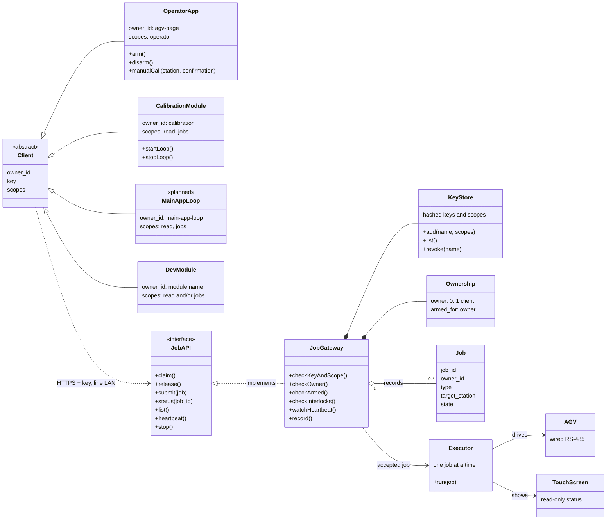
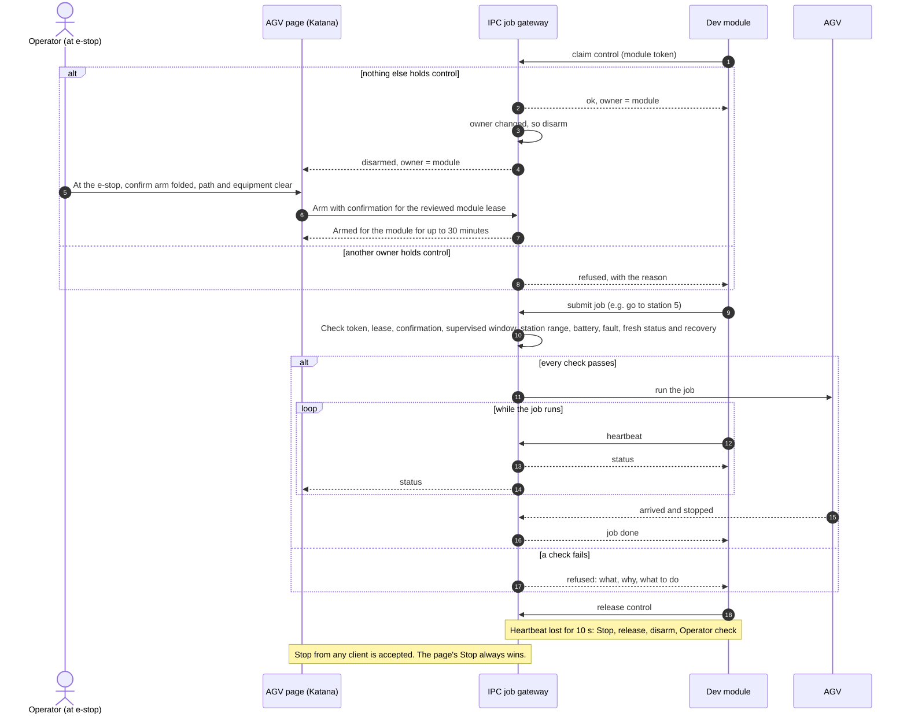
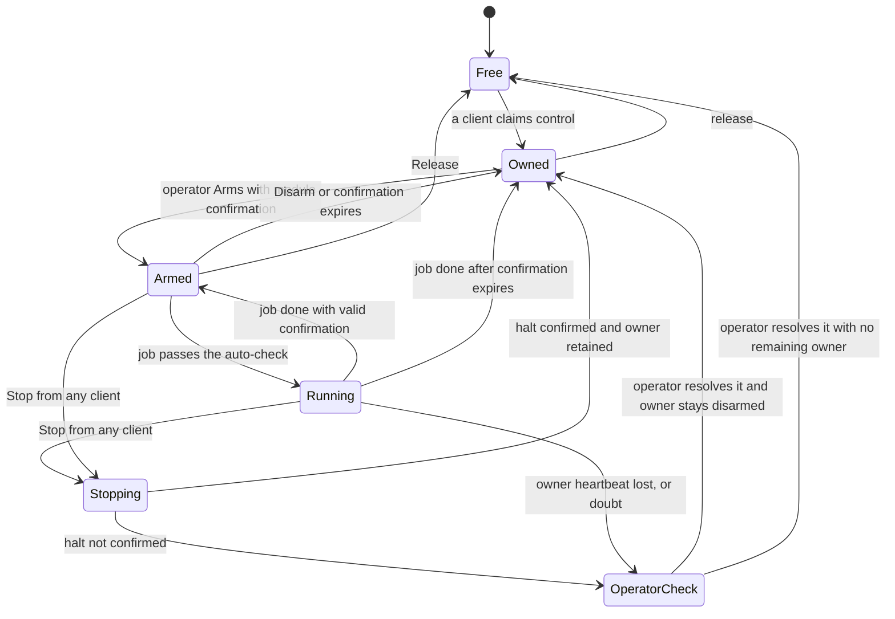

# IPC job gateway

The vehicle IPC owns admission, key scopes, one client lease and one executing
job. Katana hosts the AGV page and the built-in **Calibration module** for test
runs. The **Main app loop** is planned for production and its owner ID
`main-app-loop` is reserved. Katana retains the recipe and plan cursor. The
IPC keeps job evidence and knows nothing about the next plan step.

All clients use the same IPC HTTPS API from the line LAN or the IPC itself.
Katana uses its service key for `agv-page` and a separate derived key for
`calibration`. The built-in
Calibration module needs no extra key file. Developer modules use individual keys
and do not use Katana's browser API. SSH is for administration and deployment.

## Get a module key

Ask the IPC administrator to give the module only its necessary scopes. The
service starts with zero developer modules enabled. The IPC stores key hashes,
client names, key IDs and scopes. It never stores developer keys in job records.

On the IPC, use the admin command with the executor's stable data directory and
a new output directory. The source release includes the same command at
`tools/anodizing-module-token` in the installed bundle. Run it under the
executor data owner or as an administrator acting for that account.

```sh
anodizing-module-token --data-dir "$EXECUTOR_DATA" add example-module \
  --scope read --scope jobs --output-dir "$MODULE_KEY_DIR"
anodizing-module-token --data-dir "$EXECUTOR_DATA" list
anodizing-module-token --data-dir "$EXECUTOR_DATA" revoke example-module
```

Give `module.key` and `ipc-cert.pem` to the account that runs the module.
Keep the key file readable only by that account. From the line LAN or the
IPC itself, connect to `https://192.168.1.251:18875` with the same pinned IPC
certificate. A module running in the IPC developer login still needs its
own scoped module key. It follows the same lease, Arm confirmation, track and
supervised travel-window rules as a module on the line LAN.
A replacement key receives a new ID. Revocation denies subsequent requests
using the old key. The operator can still see records attributed to that key.

Module developers must use the keyed APIs for module operations. Module code
must not access devices, application files, databases, Bluetooth, SSH or
other host services directly.
The operator-approved IPC developer login retains its host privileges.
Installing a module key and certificate is credential setup. Future
camera, UR10e and PLC resources will use keyed APIs as well. The tower
light reflects executor state. A module can read the cached `tower_light`
field with its read scope. The gateway provides no tower light controls,
including through the raw scope.

## API

Send `Authorization: Bearer <key>` on every request, including Stop.
POST bodies use JSON. The values below show the shape of API calls.

| Request | Scope | Body or response |
| --- | --- | --- |
| `GET /v1/health` | `read` | Protocol, executor boot and capabilities |
| `GET /v1/status` | `read` | Current owner, Arm binding, interlock state and the caller's active job if any |
| `GET /v1/status?job_id=visit-1` | `read` | Retained state and evidence for the caller's job |
| `GET /v1/jobs` | `read` | List of the caller's job records |
| `POST /v1/claim` | `jobs` | Send `{}`. Retain the returned `lease_id`. |
| `POST /v1/heartbeat` | `jobs` | Send `{"lease_id":"your-lease","sequence":1}`. Advance the sequence on every renewal. |
| `POST /v1/submit` | `jobs` | Send the job below after reading the current Arm and Stop generation. |
| `POST /v1/release` | `jobs` | Send `{"lease_id":"your-lease"}` after work has settled. |
| `POST /v1/stop` | Any valid key | Send `{}` or supply a unique `stop_id` to identify a retry. |

`device.battery_trend` estimates the change in battery percentage from
fresh reports. Values are `charging`, `in_use`, `steady` or `null` when
an estimate is unavailable. See the [IPC touchscreen](MANUAL.md#ipc-touchscreen).

```json
{
  "lease_id": "your-lease",
  "stop_generation": 42,
  "job_id": "visit-1",
  "type": "station_visit",
  "version": 1,
  "params": {"station": 2}
}
```

A repeated job ID and identical payload returns the current recorded disposition.
A jobs-only key receives a minimal receipt on first acceptance and retry.
A key with `read` scope can
retrieve checkpoints and results. A refused submission keeps its refusal
status on retry. A changed payload conflicts. After an ambiguous response,
keep the original job ID and follow the operator's recovery procedure.
Each job records the originating client and key ID. Refusals retain the
reason, validated request fields and a request digest for retry checking.
The operator page can see jobs from all clients.

## Ownership, Arm and Stop

Claim only when the executor is idle and available. On the AGV page the
operator selects `agv-page` or `calibration`, or observes the name of the
module that claimed the executor. Releasing or changing owner disarms the IPC.
The operator at the physical e-stop connects and Arms for the current owner
on the AGV page. When a module holds control, choose **Armed**, verify the
module's name, and enter the operator's name. Confirm “I am at the e-stop,
the arm is folded, and the path and tank equipment are clear.”
The page shows **Armed for** the module,
the confirmation expiry in local time, and a countdown. Manual station calls
from the AGV page keep their fresh per-call confirmation.

The IPC records the operator, browser enrollment, owner, lease, executor
boot, confirmation time and expiry. The confirmation lasts at most 30
minutes. Lease and confirmation deadlines count time spent in IPC suspend.
Owner change, release, heartbeat loss, Stop, Operator check,
disarm, disconnect or executor restart clears it. When it expires, the
operator must Arm again before another move can start. A move already under
way follows its existing arrival, interlock and Stop rules.

Module station visits require that current confirmation, fresh feedback,
station range, battery, fault status, the supervised travel window and the
other configured interlocks. By default, the isolated track refuses module
station visits and raw motion. If its administrator sets
`ANODIZING_MODULE_TRAVEL_ON_ATTESTED_TRACK=1` on the IPC, the operator's
Arm confirmation supplies the folded-arm, clear-path and clear-equipment
checks in place of the hardware interlocks on that track. The window must
be open and the reported battery above the floor. At the final send, the
IPC rechecks the applicable track rules, current owner, lease, Stop
generation and Arm confirmation. Live recipe travel and dips remain fenced.

Keep heartbeats going during a job and while waiting to be Armed. Send one
each second. Ten seconds without an advancing heartbeat causes IPC Stop,
hold, disarm, ownership release and Operator check. Stop remains available
with any valid IPC key. The AGV page forwards Stop with its Katana service key
even from an unenrolled browser. A pending Stop latches ahead of ordinary
actions and stays pending across link loss until current-boot feedback after
the halt confirms it. The physical e-stop is the emergency control.

## Raw commands (dev only)

The IPC administrator can issue a development key with `--scope raw` on
`anodizing-module-token add`, or add it to an existing key with
`anodizing-module-token grant NAME --scope raw`. Use `--expires HOURS` to
set the lifetime. With the extended-grant setting off, the default is 8
hours and the limit is 24 hours. To opt in on the IPC, give the key
administration command `ANODIZING_RAW_GRANTS_USE_TRAVEL_WINDOW=1` and the
IPC's configured `ANODIZING_MANUAL_TRAVEL_UNTIL` in its environment. The
default request is still 8 hours. Any request that would run longer than
the open supervised window expires at the window's end. The setting
applies when the administrator issues or renews a grant.
`list` shows the calendar cutoff in UTC. The IPC checks the calendar cutoff
and the boot-time deadline at authentication and final send. The earlier
deadline ends raw access and preserves ordinary scopes. The running executor
latches expiry for the grant after either cutoff is reached. An IPC reboot
or a grant from before this clock format requires a new grant. The IPC
orders registry updates against the final send. During motion the speed and
distance watcher checks samples and can halt without waiting for the registry
or wire journal.
Issue `jobs` as well if the client needs to claim
ownership and renew its lease. The page and built-in Calibration credentials
have no raw access. A new key registry starts empty.

Send `POST /v1/raw` with a command name, an args object, and the current
`lease_id` for motion or settings. Reads may omit the lease. The executor
builds the frame and checksum. Raw reads return `reply_hex` and `decoded`.
A client that also has `read` gets those fields for motion and settings,
plus the snapshot for a speed change. A mutation without `read` returns
a request `id`, `verified` and the snapshot ID if the speed changed.

| Command | Class | Args and conditions |
| --- | --- | --- |
| `query_status` | Read | `{}`. Returns a fresh status report. |
| `read_speed` | Read | `{}`. Reads the documented drive-speed register. |
| `call_station` | Motion | `{"value":2}`. Integer station in the learned range and adjacent to the confirmed stopped station. Requires 500 m/h set speed and a measured speed at or below 500 m/h, with a 3 m sampled cutoff and 30 s travel timeout. |
| `stop`, `pause` | Motion | `{}`. Uses the existing priority halt and confirmation path. Stop selects the wire halt by drive mode. Pause requires station-call mode. |
| `set_speed` | Settings | `{"value":500}`. Integer m/h from 500 to 4,000, at or below the currently read setpoint. Requires a fresh, disarmed, stopped report from the same vehicle. |

Raw motion requires a valid operator Arm confirmation for the current
owner, lease and executor boot. The IPC checks it again before dispatch.
Live admission keeps the supervised window, fresh feedback, fault, battery
and obstacle checks. The isolated track also requires the explicit opt-in
and battery above the floor. Outside that track live motion requires
qualified local interlocks. The motion monitor halts when feedback breaches
its caps or becomes unverified. Sampling,
communications and braking affect the actual stopping point. The regular
`/v1/stop` still accepts any valid key. Raw Stop and Pause use the
bounded module receipt lane. Katana keeps its separate Stop transport
and page receipt capacity.

Forward and Reverse carry no bounded distance. Resume reuses an earlier
target. Both are blocked, along with optional attachment and rotation
commands, unverified registers and route or Bluetooth settings. The wired
allowlist blocks changes to obstacle sensing, bumpers, e-stop protection,
speed limits and auto-start.

Before a speed write the IPC reads the old value and commits a snapshot. It
sends one write and reads back the speed. To restore, send
`POST /v1/raw/undo` with `{"lease_id":"your-lease","snapshot_id":"saved-id"}`.
Use the original key and the latest applicable snapshot for that vehicle.
The IPC verifies that the current value still equals the snapshot's written
value. The undo may restore exactly the saved previous value. The IPC logs
the undo and verifies it by read-back. For a different live value or an
unverified result, review the AGV and saved evidence before trying again.

The IPC refuses raw traffic while the main app or Calibration owns control,
a job or recipe is active, Stop is pending, or Operator check is open. After
raw access the next normal job needs a fresh status reply. Lease release,
heartbeat loss or raw expiry raises Operator check if settings were written
or their outcome is uncertain. The check names snapshot IDs and values.
Resolve it before using a fresh lease to undo. The AGV page shows recent raw
commands and speed snapshots. The IPC executor journal retains the raw
request evidence. The gateway revalidates the grant after reading the
body and at executor admission. A validated refusal records the command,
client and key IDs, reason and request digest. The journal omits the body.
The live wire log tags bytes during the request with UTC, client name,
key ID and request ID.

The fake executor uses simulated replies. The example can read status
without claiming control. Use a fake key with `read` and `raw` scopes and
connect the fake AGV before running it.

```sh
python examples/module_station_visit.py https://127.0.0.1:18875 module.key ipc-cert.pem --raw-status
```

## Enroll the Katana operator browser

The administrator generates the browser key once on Katana and stores it in
a private file outside the application data directory. Configure the service
with `ANODIZING_OPERATOR_KEY_FILE`. Run it as the operator desktop account
and let the administrator access the file through the administrative account.
The service uses this key only for browser enrollment. The browser stores
the signed enrollment in the tab's session storage and sends it to the
exact origin in `X-Operator-Enrollment`.

On the Katana desktop, open **Dev console** at **http://dev.localhost:8880/dev/**,
choose **Enroll this browser**, and paste the key. Use this address for
operator controls and enroll once on your first visit to the new origin.
Old bookmarks redirect with their hash route and omit the query string.
The enrollment survives reloads in that tab for up to 12 hours. Enroll
again in a new tab or after expiry.
The page keeps **Stop** available before enrollment and after expiry.
To revoke enrollment, replace the key file and restart the operator service.
Browser, Katana service and developer keys have separate uses.

## Transport and firewall

Set `line_network.ipc_address`, `line_network.line_subnet` and
`line_network.ur10e_subnet` in the IPC's private site profile. The HTTPS
port defaults to 18875 and may be set with `line_network.module_api_port`.
Generate the self-signed certificate on the IPC with the IPC address in its
IP subject alternative name. Put `module-api-cert.pem` and the private
mode-0600 `module-api-key.pem` in the executor data directory. Only the
public certificate is copied to clients. Replace both configured pins
before rotating the executor certificate.
The reference module client requires the IPC certificate and refuses HTTP
redirects.

Allow the configured line subnet on `br-ipc-dev` to reach the IPC line
address on TCP 18875. Before the deny for other traffic to that address and
port, also allow `lo` with the IPC line address as both source and
destination. The listener rejects sources outside the configured subnet.
Failed-key responses are rate-limited and logged without recording keys.
The two IPC loopback HTTP listeners each admit up to four workers. On
18875, IPC-local clients have a four-worker budget separate from line-LAN
clients. The cached loopback status display remains available to the kiosk.

Set Katana's executor port, `ANODIZING_EXECUTOR_CERT_FILE` and
`ANODIZING_EXECUTOR_TOKEN_FILE`. Katana uses `line_network.ipc_address`
in its own private site profile. The IPC credential file holds two SHA-256 hashes, one for the Katana service
key and one for the derived Calibration key. The lines use
`sha256:<operator-digest>` and `calibration-sha256:<calibration-digest>`.
The AGV controls and operator job list use the operator key. The Calibration client
uses its derived key for its own jobs. Katana's browser enrollment is a separate
credential.

Set `line_network.stop_api_port` to 18876 on the IPC and Katana for
reserved Stop delivery. The IPC uses the same TLS certificate as 18875
and accepts only the static `line_network.katana_cidr` /32 and the Katana
operator service key. The listener gives pre-authentication traffic a short
deadline and authenticated Stop its own bounded capacity. It serves Stop
and health. Katana's source address must differ from the IPC's address.
On Katana, restrict outgoing TCP connections to the IPC's 18876 endpoint
to the dedicated operator service UID. Katana serializes its Stop sends on
that route. Use the operator service account for pinned health on 18876.
On `br-ipc-dev`, allow that one source to the
IPC line address on TCP 18876, then drop other traffic to that address and
port. Install the firewall rule before enabling the listener.

Katana sends Stop to 18876 first and retries a failed delivery on 18875
with the same Stop ID. Both the fallback and later retries proceed while
the witness write is pending. Confirmation stays pending until the evidence
is durable. The AGV page reports a primary-route failure even after a
successful fallback. Other gateway traffic and status checks use 18875.
Remove the old `executor_link.stop_loopback_port` setting and disable the
`anodizing-ipc-stop-forward.service` user unit once pinned health passes
on both ports.

## Local fake instance

Use two private scratch data directories. Put this synthetic
`site-profile.json` in both, using free ports for the three IPC listeners
and the Katana browser app.

```json
{
  "line_network": {
    "ipc_address": "127.0.0.1",
    "line_subnet": "127.0.0.0/8",
    "ur10e_subnet": "192.0.2.0/24",
    "module_api_port": 18875
  }
}
```

In the fake IPC directory generate a temporary certificate with
`subjectAltName=IP:127.0.0.1`. Use distinct synthetic keys for IPC service and
browser enrollment and keep their files mode 0600 outside the browser data
directory. Start two instances from the repository root.

```sh
./start-ui.sh --no-browser --role executor --fake-executor \
  --port 18873 --status-display-port 18874 --data-dir "$FAKE_IPC_DATA" \
  --executor-token-file "$FAKE_IPC_SERVICE_KEY"

./start-ui.sh --no-browser --port 8870 --data-dir "$FAKE_KATANA_DATA" \
  --executor-port 18875 --executor-token-file "$FAKE_IPC_SERVICE_KEY" \
  --executor-cert-file "$FAKE_IPC_DATA/module-api-cert.pem" \
  --operator-key-file "$FAKE_BROWSER_KEY"
```

Provision a synthetic module key with both scopes against the fake data
directory. Enroll the fake browser and use the standard-library example
to claim control, wait for an operator Arm in the fake instance, submit,
poll and release.

```sh
PYTHONPATH=src/anodizing-modules/app python3 examples/module_station_visit.py https://127.0.0.1:18875 \
  "$MODULE_KEY_DIR/module.key" "$MODULE_KEY_DIR/ipc-cert.pem" 1
```

For a fake Calibration recipe, add the configured `--programme-file` to the
fake Katana command. Configure independent fake PLC setpoints on the fake
executor as described in the [architecture](ARCHITECTURE.md).

## Confirmed design

The IPC requires a claimed owner before any Arm. Confirmation applies to the
current module lease and boot. Stop leaves the IPC disarmed after halt
confirmation, with the current owner retained until release or lease loss.

### 1. Modules and interfaces (class diagram)



### 2. A dev module runs one job (sequence diagram)



### 3. Gateway states (state machine, draft)



### 4. Access rules

| Action | Operator app | Calibration module / main app loop | Dev module |
|---|---|---|---|
| Talks to the IPC through | job API over line LAN, HTTPS + own key | job API over line LAN, HTTPS + own key | job API over line LAN, HTTPS + own key |
| Read status and jobs | Yes | Yes | Yes |
| Take control | Yes | If nothing else holds it | If nothing else holds it |
| Submit a moving job | Yes, with the per-call confirmation | Yes, with a valid Arm confirmation and interlocks | Yes, with a valid Arm confirmation and interlocks |
| Arm / Disarm | Only here | No | No |
| Stop | Yes, always wins | Yes | Yes |
| Bluetooth maintenance | Bluetooth page only | No | No |
| Allowlisted wired raw commands | No | No | Yes, with an explicit expiring raw grant and the command's interlocks |
| Files, devices, SSH, databases directly | n/a | No, keyed API only | No, keyed API only |
| Key scopes | operator | read + jobs | read, jobs and/or expiring raw, set by admin. Stop with any valid key. |
| Credential | saved operator key, with a 12-hour browser enrollment | built in | saved key file with its hash stored on the IPC. An administrator issues and revokes keys. |
