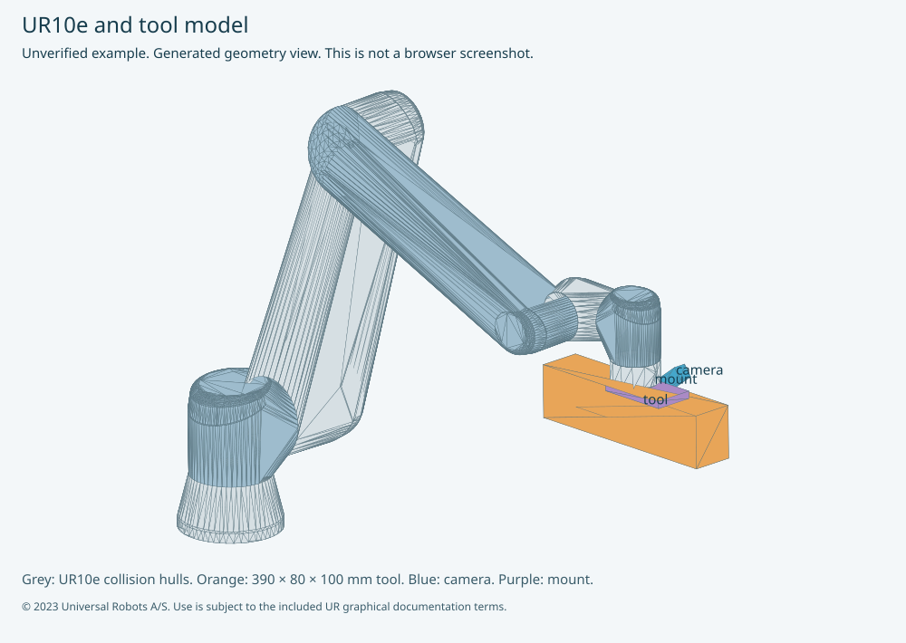

# UR10e camera calibration

## UR10e model and calibration collision review

The editor now shows the nominal UR10e, the tool box, and separate camera and mount boxes. It supports joint-pose changes, cell boxes and saved-path review. Box fields identify the tool0 or base frame. The generic model does not include this robot’s factory calibration. Read the [detailed review guide](docs/COLLISION_REVIEW.md).



This is a generated geometry view, not a browser screenshot. The hand-eye review adds conservative joint-path checks and provides tilt and roll controls. The bundled scene blocks automatic motion until the physical model and cell are confirmed. Configure and verify native UR tool and safety settings separately. A green preview or confirmed profile is not a safety certification.

An explicitly selected version-1 scene can use `"collision_scope": "supervised_self"`
for an attended calibration trial. It must keep `environment_complete: false` and
`obstacles: []`. The physical arm/attached-model confirmation and collision solver
are still required. Arm self-collision, attached envelopes, swept paths, controller
limits and phase approvals remain active. External objects are not checked.
The scope is recorded in the accepted scene and path results. Omitting the field,
or selecting `"cell"`, retains the complete-cell requirement.


Calibrate a RealSense RGB camera using a ChArUco board. Choose the matching setup
in the UI; each uses its own capture procedure.

| Setup | Camera | Calibration board | Result |
| --- | --- | --- | --- |
| **Eye in hand** | On robot flange | Fixed on platform | `camera_in_flange` |
| **Eye to hand** | Fixed on platform | On robot flange | `camera_in_base` |

## Offline tool box draft

In calibration Setup, choose **Open tool box draft**. The offline editor also works by opening the packaged `web/tool-envelope.html` file directly alongside its `.css` and `.js` files; no robot, camera or project is needed. The 390 × 80 × 100 mm example and centre (0, 0, 50) mm are illustrative, not measurements. The mounting orientation remains unverified. The tool excludes the separate camera and mount. The top-centre preset places the flange at the local negative-Z face centre. The dashed margin expands each box face.

Import/export uses a portable JSON object with exactly `version: 1`, `type: "tool_bounding_box"`, `frame: "tool0"`, `dimensions_m` (three full extents along the box-local X, Y and Z axes), `pose_in_flange` with `xyz_m` and `rpy_rad` (roll, pitch, yaw; Rz(yaw) × Ry(pitch) × Rx(roll)), `clearance_m`, `assembly_coverage` (`unconfirmed`, `tool-only`, or `includes-camera-mount`), `status: "draft"`, and `purpose: "visualization_only"`. RPY is not a UR rotation vector. Input bounds are shown in the editor. Files contain no robot settings or project data.

The tool-only JSON remains a visualization draft. Calibration uses the separate collision-scene format described above. Teacher motion integration remains open. Native UR tool spheres and safety planes remain a separate layer.

## Start

Place `charuco-generator` and `charuco-realsense` next to this repository.
Install Python 3.11–3.13 and Tk (`python3-tk` on Ubuntu/Debian), then run:

```sh
./start_calibration_eye_in_robot.sh
```

The launcher creates `.venv` and installs dependencies. Set `PYTHON_BIN` to choose
Python when creating a new environment.

For either setup, print the board at 100%, measure its square size and use a flat
backing. Enter the robot IP, board manifest, board name and a new session folder.
Select RGB intrinsics for this camera/resolution if available; otherwise capture
uses the factory model. Check clearance and keep the emergency stop accessible.

## Eye to hand — fixed camera, board on flange

1. Secure the camera to the platform and the board to the flange.
2. Keep the robot in **Local Control**, powered on with brakes released. Enable
   RTDE receive (port **30004**) and the read-only Primary interface (**30011**)
   in the robot/network configuration. The software reads calibrated poses and
   the active TCP offset; it does not upload a robot program or take motion control.
3. Jog using the pendant until the whole board is visible, roughly centred and
   0.3–0.6 m away. Complete the preparation checks and choose **Check view**.
   This checks both the camera and the calibrated pose source.
4. Continue to Capture and choose **Start manual collection**. Jog the board,
   release the jog/Freedrive control, wait for settling, then choose **Capture view**.
   Collect 10–15 views with different positions, distances and tilts about at least
   two axes, spanning at least 30°. Keep the complete board visible. Choose **Finish collection**.
5. In Results, choose **Solve session**. Prefer **GOOD**; investigate warnings and
   recollect poor data. The software estimates both `camera_in_base` and
   `board_in_flange`; no measured board mounting offset is needed.
6. Keep both mounts unchanged. Choose a new verification folder and **Collect
   different views (manual)**, still in Local Control. Collect fresh varied views,
   finish, then choose **Verify calibration**. Default limits are **2 mm and 1°**.

**Stop operation** ends eye-to-hand capture; it does not stop pendant-controlled
robot motion. Automatic planning is not available for this setup. The eye-to-hand
UI uses manual verification; CLI `--mode replay` is a separate operation that
requires Remote Control, endpoint review and explicit motion approval.

## Eye in hand — camera on flange, fixed board

1. Secure the camera to the flange and keep the board fixed on the platform.
2. Set the first visible board pose using the pendant, then select **Remote Control**
   and disconnect other RTDE control clients. Complete the preparation checks.
3. Choose **Check view**, then **Inspect plan (no motion)**. Review targets and clearance.
4. Choose **Start automatic collection**, starting at 0.1 rad/s. Approve the three
   30 mm probe moves and subsequent calibration plans. Success returns to the start.
5. Choose **Solve session** and review the verdict and warnings. Prefer **GOOD**.
6. Keep the board fixed and choose a new verification folder. Collect fresh views
   using replay, then choose **Verify calibration**. Default limits are **2 mm and 1°**.

The eye-in-hand motion pipeline uses RTDE control. This review adds conservative
model checks for complete joint paths and returns. A confirmed measured scene is
required for automatic motion. Its software stop is not an emergency stop.

Automatic `collect` (including `--dry-run` planning and `--mode replay`) and the
offline `python -m ur_handeye.collision` checker accept `--robot-model FILE` with
`--collision-scene FILE` or `--scene FILE`, respectively. Omitting it uses the
bundled nominal model. The scene SHA-256 must match the exact selected model bytes;
external models must retain the bundled UR10e body geometry, link order and tool0.
Joint origins must be within 0.1 m and 0.2 rad of the nominal joint origins, with
coordinates within 1 m. A selected model that is missing, changed or invalid is
refused. A factory model corrects kinematics only: confirm physical geometry,
uncertainty and cell obstacles before automatic motion. The native web preview
still displays the bundled nominal model until its caller supplies matching assets.

## Use the result

Results are saved to `SESSION/calibration.json`; repeated UI solves use new filenames.
Matrices use metres and camera optical coordinates. For homogeneous points:

```text
Eye in hand: p_base = T_base_flange @ camera_in_flange.matrix @ p_camera
Eye to hand: p_base = camera_in_base.matrix @ p_camera
```

Applications must handle the explicit `type` field. Sessions record their setup;
older sessions without a setup remain eye-in-hand sessions. Mixed setups are refused
for verification and replay. Physical UR10e/RealSense/URSim validation is still pending.

## Command line and offline tools

```sh
./start_calibration_eye_in_robot.sh collect \
  --calibration-type eye_to_hand --mode manual --robot-ip ROBOT_IP \
  --manifest PATH/board_manifest.json --board BOARD_NAME --output sessions/fixed-camera
./start_calibration_eye_in_robot.sh solve --session sessions/fixed-camera
./start_calibration_eye_in_robot.sh --help
```

Solving selects the setup from the session. Use a separate fresh session with
`verify --calibration FILE --session FRESH_SESSION`. `locate` accepts both result types.
For an eye-to-hand camera check, include `check --calibration-type eye_to_hand`.

For inaccurate RGB intrinsics, use **Estimate RGB intrinsics from session**, solve
again and independently verify. The CLI equivalents are `intrinsics --session SESSION
--output NEW_FILE` and `solve --session SESSION --intrinsics NEW_FILE`.
**Calibrate RGB and solve** combines intrinsic estimation and the hand-eye solve
into one offline operation (`calibrate --session SESSION --intrinsics-output NEW_RGB_FILE
--output NEW_CALIBRATION_FILE`). Estimated intrinsics remain unvalidated until fresh
views pass verification. The UI remembers a selected real camera model across restarts;
serial and resolution checks still apply. `ui --calibration FILE` opens a saved result.

Use `reprocess --session SESSION --output NEW_SESSION` to apply updated corner filtering
to all saved raw frames without changing the original recording. It preserves robot
poses, setup type and motion rejections. Reprocessed data is not independent verification.
An intrinsic fit's training error does not establish physical accuracy.

**Try eye-in-hand simulation** runs without hardware. The rendered simulator supports
eye in hand only; simulated results must not be used on hardware.
Run tests with `.venv/bin/python -m pytest -q`.

For the optional offline factory-posture test, set `ANODIZING_FACTORY_FIXTURES`
to a private directory containing `model.json`, `scene.json`, `preflight.json`
and `kinematics.json`. Use the matching factory model and scene, with distinct
saved postures in the preflight and kinematics records.
